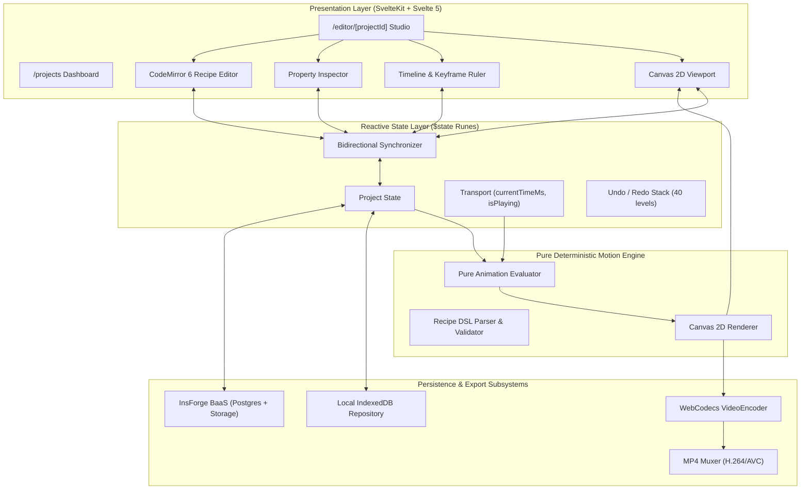

# Technical Architecture — TickrStudio

## System Overview

TickrStudio is built with a pure decoupled architecture where the animation model, evaluation engine, and renderer are completely isolated from the UI framework. This allows the core motion graphics engine to run in browser threads, web workers, and unit tests without DOM dependencies.



---

## Canonical Timeline Model

The source of truth for every composition is the `TimelineProject` JSON schema (`schemaVersion: 1`):

```typescript
interface TimelineProject {
  schemaVersion: 1;
  id: string;
  name: string;
  createdAt: string;
  updatedAt: string;
  settings: {
    width: number;
    height: number;
    fps: number;
    durationMs: number;
    background: string;
  };
  objects: SceneObject[];
  tracks: TimelineTrack[];
  assets: ProjectAsset[];
}
```

### Scene Objects (Discriminated Union)
Every element on canvas is a `SceneObject` typed as `'text'`, `'rect'`, or `'ellipse'`. Each object possesses:
- A base `Transform` (x, y, scaleX, scaleY, rotationDeg, opacity).
- A map of animated `Keyframe<T>` sequences indexed by property name.

---

## Pure Deterministic Evaluator

The evaluator is a pure mathematical function:
```typescript
function evaluateTimeline(project: TimelineProject, timeMs: number): RenderState;
```
For any given composition and millisecond timestamp, the evaluator performs:
1. Active clip visibility determination.
2. Binary search / range bounding between adjacent keyframes.
3. Normalized progress calculation `t = (timeMs - kfA.timeMs) / (kfB.timeMs - kfA.timeMs)`.
4. Easing curve evaluation (`linear`, `easeIn`, `easeOut`, `easeInOut`).
5. Matrix transformations and color interpolations.

Because the evaluator produces no side effects and references no DOM elements, preview playback and offline frame-by-frame video export share identical mathematical guarantees.
